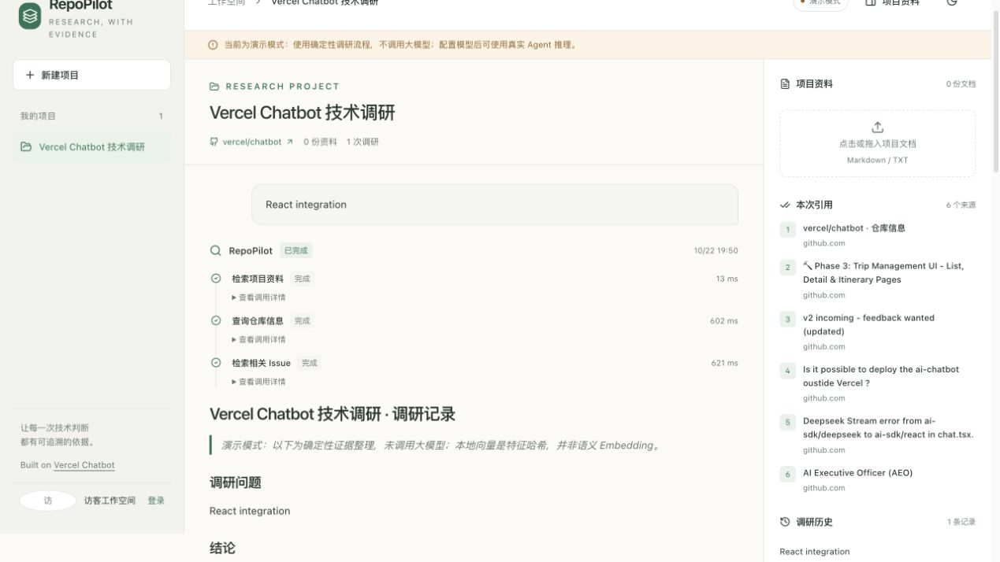

# RepoPilot

面向开源项目选型的调研与文档问答工作台。创建项目、导入需求文档，再通过仓库信息、Issue 与文档检索生成可回查来源的调研报告。

基于 [Vercel Chatbot](https://github.com/vercel/chatbot) 二次开发，使用 React、TypeScript、Next.js、Node.js、AI SDK 与 PostgreSQL / pgvector。原始说明保存在 [docs/UPSTREAM_README.md](docs/UPSTREAM_README.md)，上游基线为 `c2f8235e1f3ea903ad8b7f61447c4f74164b5c58`，保留 Apache-2.0 [LICENSE](LICENSE)。



## 本地启动

需要 Node.js 22 与 pnpm。默认启动器管理本地 PGlite 数据库，不需要先安装 Docker 或 PostgreSQL。

```bash
pnpm install --frozen-lockfile
pnpm run setup:local
pnpm dev
```

打开 [http://localhost:3000/research](http://localhost:3000/research)。首次访问会建立上游提供的访客会话；如需跨浏览器保留同一身份，可使用注册与登录。未提供 `AUTH_SECRET` 时，`pnpm run setup:local` 会创建或补充本地配置与随机会话密钥，保留已有配置内容。初始化脚本通过 `node --import tsx` 执行。

`pnpm dev` 与 `pnpm start` 都通过 `scripts/serve.ts` 启动：父进程独占本地数据库，Next.js 工作进程通过本地 PostgreSQL 协议连接访问。按 Ctrl+C 会关闭应用和数据库。服务运行时不要另行执行 `setup:local`；若需要第二个开发实例，为它设置独立的 `PGLITE_DATA_DIR`。

默认是**明确标注的演示模式**：无需模型密钥，可以体验项目、导入、检索、工具状态、报告和历史流程。它执行确定性报告组织与本地特征哈希检索，不代表真实 LLM 推理效果。正常运行查询真实 GitHub API；未配置令牌时会受到 GitHub 匿名访问额度限制。

## 跑一遍完整流程

1. 创建调研项目，填写一个公开 GitHub 仓库地址。
2. 导入 [examples/editor-requirements.md](examples/editor-requirements.md) 和 [examples/react-team-context.txt](examples/react-team-context.txt)。
3. 提问：“结合我们的 React 和中文输入需求，分析这个项目的接入风险，列出需要核实的事项。”
4. 查看工具状态和来源，打开引用原文核对结论。
5. 导出 Markdown 报告，再打开历史记录。
6. 试验资料不足、无效仓库、停止生成和重新发起，观察错误与记录。

## 接入真实模型

在本地 `.env.local` 中配置，不要把真实密钥提交到 Git。

```dotenv
RESEARCH_MODE=live
MODEL_API_KEY=填入你的密钥
MODEL_BASE_URL=https://api.openai.com/v1
MODEL_NAME=填入支持工具调用的模型名称
EMBEDDING_MODEL=text-embedding-3-small
```

`MODEL_BASE_URL` 使用 OpenAI 兼容接口地址。Embedding 默认复用模型密钥和地址；若聊天模型供应商不提供 Embedding，需要单独配置 `EMBEDDING_API_KEY`、`EMBEDDING_BASE_URL` 和 `EMBEDDING_MODEL`。修改配置后重启应用。切换 Embedding 模型或从演示模式切到真实模式后，重新导入资料，确保文档向量与查询处于同一向量空间。

配置了供应商不等于已经完成联调；真实模型、真实 Embedding 和 GitHub 的验证范围见 [docs/VERIFICATION.md](docs/VERIFICATION.md)。

## 配置项

| 变量 | 用途 |
| --- | --- |
| `AUTH_SECRET` | 会话签名；本地首次 `setup:local` 自动生成 |
| `AUTH_URL` | 浏览器访问的完整应用地址；HTTPS 反向代理部署时需显式设置，如 `https://research.example.com` |
| `RESEARCH_MODE` | `demo` 或 `live`，默认 `demo` |
| `POSTGRES_URL` | 可选；设置后使用独立 PostgreSQL，需支持 pgvector |
| `PGLITE_DATA_DIR` | 本地 PostgreSQL 数据目录，默认 `.data/local-postgres` |
| `MODEL_API_KEY` | 真实聊天模型密钥，仅服务端使用 |
| `MODEL_BASE_URL` | 模型 API 地址，默认 `https://api.openai.com/v1` |
| `MODEL_NAME` | 真实模式使用的聊天模型 |
| `EMBEDDING_API_KEY` | 可选；默认复用 `MODEL_API_KEY` |
| `EMBEDDING_BASE_URL` | 可选；默认复用 `MODEL_BASE_URL` |
| `EMBEDDING_MODEL` | 默认 `text-embedding-3-small` |
| `GITHUB_TOKEN` | 可选；提高 GitHub API 访问额度 |
| `APP_ORIGIN` | 可选；反向代理部署时填写浏览器访问的完整来源，如 `https://research.example.com` |
| `RESEARCH_FIXTURES` | 仅测试时设置为 `1`，使用固定 GitHub 夹具 |

本地 PGlite 数据目录由单个启动器进程持有，内部 PostgreSQL socket 只监听 `127.0.0.1` 的随机端口；Next.js 工作进程共享该连接入口。多实例部署应使用独立 PostgreSQL。文件与环境配置的实际忽略规则见 `.gitignore`。

本地 HTTP 开发可不设置 `AUTH_URL`，或设置为实际的 `http://localhost:3000`。通过 HTTPS 反向代理访问时，将 `AUTH_URL` 与 `APP_ORIGIN` 都设置为用户实际访问的外部来源，并重启服务。会话 cookie 的 Secure 读取策略根据配置 / 请求 URL 的协议选择，不能仅根据 `NODE_ENV=production` 推断 HTTPS；兼容旧配置名 `NEXTAUTH_URL`，新配置优先使用 `AUTH_URL`。

## 检查与测试

```bash
pnpm typecheck
pnpm test:unit
pnpm test:research
pnpm test:e2e:research
pnpm test:persistence
pnpm build
pnpm test:production
```

首次运行浏览器测试可能需要 `pnpm exec playwright install chromium`。固定案例评测使用 `pnpm eval:research`，运行条件及测试证据见 [docs/VERIFICATION.md](docs/VERIFICATION.md)。测试环境使用隔离的数据目录和固定外部数据；不能用夹具结果代替真实供应商验证。新增 CI 是 `.github/workflows/research-ci.yml`；保留的上游工作流已改为手动运行，避免与新应用的独立验证混在一起。

`pnpm typecheck` 会先生成 Next.js 路由类型，再执行 TypeScript 检查。生产模式可在 `pnpm build` 后使用 `pnpm start` 启动，同样由本地数据库启动器管理资源。`pnpm test:production` 需要已有构建产物，会启动隔离的生产 HTTP 服务，验证访客会话、项目接口、正常退出和构建文件追踪边界。

## 实现过程与面试复盘

- [开发记录](docs/DEV_LOG.md)：需求、克隆基线、实现阶段与实际验证记录。
- [构建记录](docs/BUILD_LOG.md)：设置与验证检查点，区分已执行结果和未验证项。
- [架构与阅读路径](docs/ARCHITECTURE.md)：从一次请求理解前端、接口、检索、Agent 与数据库。
- [技术决策](docs/DECISIONS.md)：选择 TypeScript、数据库模式和单 Agent 的原因与代价。
- [提交阅读指南](docs/COMMIT_GUIDE.md)：结合规范提交、开发记录和差异学习实现过程。
- [接口说明](docs/API.md)：领域接口、SSE 事件与错误边界。
- [面试复盘](docs/INTERVIEW_GUIDE.md)：演示顺序、技术追问与个人贡献边界。
- [验证记录](docs/VERIFICATION.md)：实测命令、结果和未验证项。

Vercel Chatbot 提供工程、鉴权和基础 UI；RepoPilot 新增项目调研领域、资料检索工具、执行过程与来源展示、报告管理和相应验证。已完成的本地验证与外部服务验证边界见 [docs/VERIFICATION.md](docs/VERIFICATION.md)。
