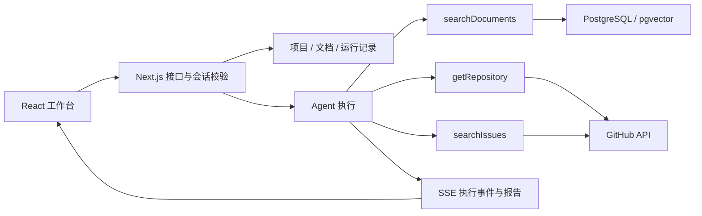

# RepoPilot 架构与阅读路径

## 一个请求怎样变成报告

用户先创建项目并绑定公开 GitHub 仓库，可补充 Markdown / TXT 需求文档。文档被分块和向量化后保存。用户提问时，服务端先验证会话及项目归属，再创建运行记录。工具调用、来源与文本增量通过 SSE 推送到浏览器；运行结果保存后可以重新打开或导出。

## 领域边界

- `ResearchProject`：调研空间及仓库地址。
- `ResearchDocument`：导入文件的处理状态、分块数量及错误。
- `ResearchRun`：一次问题对应的执行状态、工具记录、来源、报告与用量。
- `ToolExecution`：工具的输入、结果、起止时间和错误。
- `ResearchSource`：可回查的文档片段或 GitHub 来源，包含获取时间。

接口契约定义在 `lib/research/types.ts`。前端可以渲染这些事实，不需要根据自然语言猜测工具是否执行成功。

## 数据与权限

项目是主要授权边界。文档及运行记录必须通过项目归属校验后才能读取、删除、取消或导出。知道资源 ID 不构成访问权限。浏览器不会持有模型供应商密钥。

本地启动使用 PGlite 提供真正的 PostgreSQL SQL 执行能力，并加载 pgvector；数据默认保存在 `.data/local-postgres`。外部 PostgreSQL 适用于需要独立数据库进程、多个应用实例及托管备份的部署。PGlite 本地模式不是多实例生产数据库。

### 本地数据库为什么由启动器持有

Next.js 会使用多个进程。模块中的全局单例只能避免当前进程内重复实例化，不能保证不同工作进程不会打开同一 PGlite 数据目录。因此 `pnpm dev` / `pnpm start` 通过 `scripts/serve.ts` 启动：

1. 按数据目录获取独占的 owner lock，阻止两个启动器同时持有该目录。
2. 执行迁移并关闭初始化引擎。
3. 由启动器唯一持有 PGlite 与 pgvector，通过 `@electric-sql/pglite-socket` 在 `127.0.0.1` 随机端口提供 PostgreSQL 协议连接。
4. 给 Next.js 子进程传入内部 `POSTGRES_URL`；各工作进程使用 `postgres.js` 连接，不直接打开本地数据目录。本地连接池上限为 1，外部数据库为 5。
5. 收到退出信号时停止应用、socket 与数据库，再清理自己持有的锁。

配置了外部 `POSTGRES_URL` 时跳过本地引擎与 socket。`pnpm build` 只构建，不同时对用户数据目录运行初始化。独立执行 `setup:local` 时会拒绝进入正在使用的本地数据库。

## 文档检索

1. 校验文件扩展名、大小、文本内容及项目权限。
2. 把内容分成有来源标识的重叠片段。
3. 生成向量并持久化，保留文件与片段的对应关系。
4. 将问题转为同一向量空间的查询，检索相关片段。
5. 把命中的原文与引用标识交给报告生成流程。

真实模式调用配置的 Embedding 供应商。演示模式可采用本地确定性哈希向量，便于无需密钥运行与回归测试；这种向量的语义能力有限，不能据此声称达到生产 RAG 效果。

## Agent 与确定性演示

真实模式通过 AI SDK 的工具循环执行模型决策。执行器限制步数、调用时间和工具参数，向前端发送真实状态。工具读取的外部内容作为资料，不能改变服务端权限或工具策略。

演示模式用于体验同一产品流程，执行确定性的资料查询与报告组织。界面必须显示演示标识，用量与模型字段不得冒充真实模型调用数据。它验证应用流程与检索链路，不能验证供应商推理效果。

## SSE 与持久记录

事件类型包含 `run`、`tool`、`source`、`text`、`done`、`error`。前端按类型分别更新状态，而不是把工具输出拼进一段聊天文本。

报告文本、工具记录和来源需要持久化。刷新后读取已保存的运行记录，与“任意进程重启后从中间步骤继续执行”是两个能力。本版只承诺实际实现并经过验证的保存与重试行为，不将界面恢复等同于后台持久任务恢复。

## 建议按这个顺序读代码

1. `lib/research/types.ts`：领域对象与事件协议；`validation.ts`：运行时输入约束。
2. `app/api/research/[...path]/route.ts`：请求边界、会话、来源校验与资源授权。
3. `scripts/serve.ts`、`lib/db/connection.ts`、`scripts/setup-local.ts`、`lib/research/schema.ts` 和 `migration.sql`：本地引擎唯一持有、工作进程连接、初始化与数据结构。
4. `lib/research/embeddings.ts`、`store.ts`：分块、两种向量模式、资料与运行持久化、检索范围。
5. `lib/research/github.ts`、`agent.ts`：真实 / 夹具数据、重试边界、工具循环、取消、报告生成与 SSE。
6. `components/research/api.ts`、`use-research-workspace.ts`：事件解析和前端状态；`index.tsx`、`views.tsx`、`index.css`：布局、交互与展示。
7. `tests/research-unit/`、`tests/research/`、`tests/research-e2e/`：分别理解纯逻辑 / 外部接口契约、API 与资料检索、浏览器用户流程。

完整练习可以从 `examples/editor-requirements.md` 开始，再把一次运行的请求与上述文件逐一对应。
